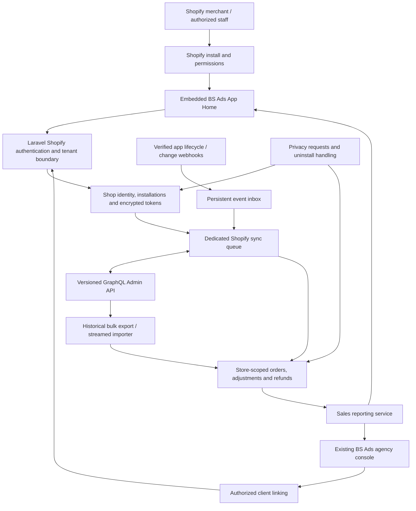

# Shopify integration architecture for BS Ads

Status: design reference. The local implementation and current setup instructions are in `shopify-app/README.md`. Shopify registration, approvals, live installation verification and production rollout remain external release gates. The short `shop_*` schema names in the implementation supersede the illustrative long entity names below.
Research date: 4 November 2026. Repository reviewed: `799a25b`.

This plan covers the Shopify requirements relevant to a historical sales and revenue integration. It is not an exhaustive Shopify changelog or an approval guarantee. Recheck the linked requirements and actual Dev Dashboard approval status before submission.

## 1. Decisions

- Build one integration in the existing Laravel 12 backend and React frontend, served from `https://sharkads.brandshark.in`.
- Use separate Shopify app registrations for pilot clients and one shared public registration later. They share application code, jobs, database, and reporting services.
- Provide an embedded, merchant-facing Shopify App Home alongside the existing agency console. Both call the same reporting services with different authorization boundaries.
- Use the GraphQL Admin API, initially pinned to `2026-10`, for historical imports and ongoing synchronization.
- Use Shopify managed installation and App Bridge ID-token exchange for embedded authentication. Implement the documented no-template flow in Laravel; the Shopify CLI manages configuration, not another mandatory production server.
- Use expiring offline access tokens from the beginning for background work in both distribution modes.
- Keep API sync authoritative. App-managed webhooks can accelerate updates and must handle lifecycle/privacy events; this is not the discarded webhook-only design.
- Start with read-only order reporting. Extensible API access does not mean requesting every Shopify permission or copying all store data.

Sources: [embedded authentication without a template](https://shopify.dev/docs/apps/build/authentication-authorization/implement-token-exchange), [managed installation](https://shopify.dev/docs/apps/build/authentication-authorization/cli-app-authentication), [distribution](https://shopify.dev/docs/apps/launch/distribution).

## 2. Requirements that change the earlier proposal

The public flow must begin on Shopify, authenticate before setup, avoid manual store-domain entry, support reinstall, and provide an embedded experience. Reviewer access must work without external SSO challenges. Any app charges need Shopify billing unless Shopify grants an exception. Present the product as reporting software, not agency matchmaking. A minimal redirect-only connector is not the proposed submission. These requirements mean the earlier external domain-entry wizard and Brandshark-only login are insufficient for the public product.

Source: [App Store requirements](https://shopify.dev/docs/apps/launch/shopify-app-store/app-store-requirements).

### Current platform baseline

| Verified rule/change | Design response |
| --- | --- |
| `2026-10` is the current stable API release. Order taxes and financial values can change after edits; fulfillment enums have expanded. | Version queries and webhook payloads, retain current financial state, handle unknown enum values, and regression-test edits/refunds. |
| New public apps cannot use non-expiring offline tokens for GraphQL. Existing public apps face delisting/new-install restrictions on 1 January 2027 and GraphQL rejection on 1 April 2027. | Implement access/refresh token storage and renewal now; do not build around permanent tokens. |
| August 2026 refresh recovery improvements retain a preceding refresh token until its replacement is used, within documented bounds. | Serialize refreshes and atomically persist the returned token pair; recovery behavior is not permission to skip atomic writes. |
| September 2026 added recovery for lost non-expiring-to-expiring migration responses. | Relevant only if migrating an old token later; new installations should start with expiring tokens. |
| Public registrations can obtain short-lived application-only tokens using signed client assertions for installed stores. Agency custom apps do not gain equivalent cross-organization client-credentials access. | Keep a token-provider boundary, but use expiring offline tokens as the common initial implementation. Application-only access is an optional later public-app optimization. |
| API `2026-01` onward permits up to five concurrent bulk queries per app/store. | Initially run one backfill per installation to protect the shared server; store operation IDs rather than assuming one globally current operation. |

Sources: [2026-10 release notes](https://shopify.dev/changelog/release-notes/2026-10), [token requirement/timeline](https://shopify.dev/docs/apps/build/authentication-authorization/migrate-to-expiring-offline-access-tokens), [August refresh changes](https://shopify.dev/changelog/posts/more-resilient-refreshes-for-expiring-offline-access-tokens), [September migration changes](https://shopify.dev/changelog/posts/more-resilient-token-exchanges-when-migrating-tokens-without-a-user-session), [application-only tokens](https://shopify.dev/docs/apps/build/authentication-authorization/application-only-access-tokens), [bulk operations](https://shopify.dev/docs/apps/build/apis/graphql-admin/bulk-operations/queries).

## 3. Permissions and history

Initial required data: store identity, timezone/currency, orders, order lines needed for financial reconstruction, discounts, tax/shipping components, refunds, and relevant payment status/transactions. Read no customer contact fields and request no order-write scopes.

- `read_orders`: normal order access, limited to orders created within the last 60 days.
- Protected customer data approval: order/refund/transaction information itself is protected data. Avoiding names, addresses, phone numbers and email reduces exposure but does not remove this approval requirement. Start with the level required for the actual selected fields; disclose any unavoidable webhook data too.
- Products, inventory, customer profiles and advanced analytics are later capabilities, requested only when a shipped feature needs them.

The supported import window is the last 60 days. Historical-order scope approval is not part of this product. App review, protected-data access and merchant consent remain distinct requirements. Display granted capabilities and actual imported coverage. Never label 60 days of accessible data as all-time history. Deleted or otherwise unavailable source data cannot be promised.

Sources: [order scopes and approval process](https://shopify.dev/docs/api/usage/access-scopes#orders-permissions), [protected customer data](https://shopify.dev/docs/apps/launch/protected-customer-data).

ShopifyQL is a separate potential analytics provider, not a synonym for the order API. The current `shopifyqlQuery` documentation requires `read_reports` and level-2 protected customer data access. Do not add it merely for convenience. Evaluate separately if exact Shopify Analytics-style reports are required; order-derived totals must not be advertised as automatically identical to every Shopify report.

Source: [ShopifyQL query requirements](https://shopify.dev/docs/api/admin-graphql/latest/queries/shopifyqlQuery).

## 4. User experience and client linking

### Pilot custom installations

1. An agency administrator creates the ecommerce (or mixed-objective) client in BS Ads.
2. An internal setup screen registers the client-specific Shopify app profile and binds its intended client; secrets remain server-side and encrypted.
3. The team configures the standard embedded entry URL, scopes and subscriptions using that profile's Shopify CLI configuration, and generates the store-specific custom installation link.
4. An authorized Shopify user follows that Shopify-hosted link and approves the app.
5. Shopify opens App Home. BS Ads validates Shopify identity, obtains tokens, retrieves the immutable Shopify shop ID, and verifies the intended client association.
6. Show permission status, historical import progress, date-range sales/revenue, sync health, and disconnect/help controls directly in App Home.

Store identity comes from verified Shopify authentication and API results. Agency setup is not a public merchant domain-entry form. Custom registration still needs the relevant order/data approvals on live stores.

### Shared public installation

1. BS Ads' Connect Shopify button directs to the Shopify listing/install surface; Shopify handles store selection and installation. Merchants may also install directly from the listing.
2. Installation/authentication completes before BS Ads asks for any account-linking setup.
3. An installation is useful independently: its merchant can see that store's history import and sales/revenue dashboard without a Brandshark Google account.
4. Agency linking requires a short-lived, single-use intent and authorization on both sides: an existing BS Ads administrator may link only an assigned client; the Shopify side must be authorized for that store. Use an explicit expiring claim/confirmation workflow when browser contexts differ.
5. A signed launch parameter alone must not attach a store to an arbitrary client. Do not auto-link by an email match or accept a caller-supplied client ID without authorization.

The public registration may use limited listing visibility; that does not remove review requirements. Define eligibility and any paid service dependency honestly in the listing. Do not assume that only existing agency clients being allowed to use the product will automatically pass review.

Source: [listing visibility](https://shopify.dev/docs/apps/launch/distribution/visibility).

## 5. Component architecture

Keep Shopify commerce separate from ad-platform connections: `PlatformConnection` currently models Google/Meta credentials and ad accounts. A Shopify store is a sales source linked to the client, not another ad account.

Suggested modules: `ShopifyInstallationService`, `ShopifyIdentityVerifier`, `ShopifyTokenProvider`, `ShopifyGraphqlClient`, `ShopifySyncCoordinator`, `ShopifyOrderImporter`, `ShopifyWebhookReceiver`, `ShopifyPrivacyService`, and `CommerceReadService`. These are module boundaries, not separate servers.

## 6. Data model

| Proposed entity | Purpose / constraints |
| --- | --- |
| `shopify_app_registrations` | Public/custom environment profile, client ID, encrypted client secret, intended client where applicable, declared scopes and configuration version. No credentials in browser responses or Git. |
| `shopify_stores` | Immutable Shopify shop GID, canonical domain, name, timezone, currency, lifecycle state. Uniqueness by source identity. |
| `client_shopify_stores` | Authorized client association. One store cannot silently contribute to two clients. UI starts with one store/client; schema permits controlled future expansion. |
| `shopify_installations` | Unique registration/store pair; encrypted token pair, both expiries, granted scopes, approval/capability snapshot, installation generation, active/revoked status. |
| `shopify_sync_runs` | Backfill/incremental/reconciliation run, bounds, operation ID, cursor/checkpoint, counts, errors, timestamps. |
| `shopify_orders` and required order components | Store/order GID uniqueness; source dates, statuses, test/cancellation flags, monetary components and currency. Preserve source version and acquisition lineage. |
| `shopify_refunds` / financial adjustments | Unique source IDs, source-effective dates and linked orders; distinguish a refund record from a successful money movement. |
| `shopify_webhook_events` | Registration/store/topic/delivery identity, signature-verified event, processing state, attempts and minimal retained payload. |
| `commerce_daily_metrics` | Derived, rebuildable summaries keyed by store/local date/currency/metric-definition version. Never the only retained financial evidence. |

Use decimal arithmetic or integer minor units with currency precision, never floating-point totals. Keep shop and presentment currencies distinct. Record provenance and lifecycle generation so a late event from an old installation cannot revoke its replacement or contaminate current data.

## 7. Authentication, isolation and credentials

- App Home uses current App Bridge and bearer ID tokens; it must not depend on third-party cookies or the existing agency Sanctum session.
- Laravel verifies JWT signature, audience against the selected registration, issuer/destination, expiry and timing claims. Canonicalize and validate shop domains before outbound requests. Untrusted launch parameters do not establish identity.
- Derive tenant context from verified identity. Shopify users can access only their store's merchant endpoints; they never become agency administrators or gain access to other clients.
- Exchange the ID token for an expiring offline access token on initial authorization; use separate online/user authorization where a user-specific action requires it. Do not exchange an offline token on every page request.
- Centralize token acquisition, exchange, refresh and reconnect under one per-registration/store lock. Persist each returned pair and expiry metadata atomically. Read lifetimes from responses; proactively renew before expiry and handle refresh expiry/revocation with an explicit reauthorization state.
- Token values never appear in logs, frontend storage, queue payloads or exception messages. Queue jobs carry internal IDs and load current credentials when executing.
- Embedded responses use Shopify-compatible framing/CSP restricted to the appropriate shop and Shopify admin; ordinary agency pages retain their normal framing protection. Bound CORS and validate mutations appropriately for each auth surface.

Sources: [ID-token verification](https://shopify.dev/docs/apps/build/authentication-authorization/id-tokens), [access-token lifetimes](https://shopify.dev/docs/apps/build/authentication-authorization/access-tokens), [expiring-token implementation](https://shopify.dev/docs/apps/build/authentication-authorization/implement-token-exchange).

## 8. Historical and ongoing sync

1. **Capability check:** retrieve verified shop metadata, actual granted scopes and resource access. Distinguish missing approval, missing merchant scope, transient error and empty dataset.
2. **Initial import:** capture an import-start watermark, then submit bounded order-history bulk queries. Persist operation IDs; poll for completion with backoff or use verified completion notifications.
3. **Streaming import:** download JSONL results with bounded memory; traverse parent/child records correctly. Retry download/import independently of submitting another export. Checkpoint batches; do not mark a failed/partial result complete.
4. **Catch-up:** query changes from before the initial watermark through a fixed upper bound after import. Upsert by source ID and version so events during backfill are not lost or overwritten by older export data.
5. **Incremental sync:** propose every 10-15 minutes using `updated_at`, a small overlap and complete pagination. Advance the durable watermark only after the entire bounded window succeeds. Process old orders updated today, not merely recent order creation dates.
6. **Reconciliation:** scheduled rolling rescans plus bounded 60-day rechecks and targeted refresh of referenced orders/refunds. Include deletion handling; an updated-order query alone cannot prove deleted records were removed.
7. **Reporting:** update affected daily partitions transactionally or rebuild them in small jobs. Expose import coverage, incomplete ranges and last successful sync rather than silently serving partial totals.

Throttle per app/store using GraphQL cost/throttle metadata, honor retry delays, retry transient failures with jitter, and inspect GraphQL errors even on HTTP 200. Do not retry permission failures indefinitely. Bulk jobs must be resumable and bounded; Shopify permits up to five concurrent bulk queries per app/store from 2026-01 and requires completion within ten days. Start below the maximum.

Sources: [bulk query lifecycle](https://shopify.dev/docs/apps/build/apis/graphql-admin/bulk-operations/queries), [API limits](https://shopify.dev/docs/api/usage/limits), [protected-resource errors](https://shopify.dev/docs/apps/launch/protected-customer-data).

## 9. App-managed webhooks and privacy lifecycle

Use change topics as fast invalidation signals followed by API reads; API history/reconciliation remains the data foundation. Register supported order/payment/update/cancellation/refund/deletion topics, bulk completion where useful, `app/uninstalled`, and scope-change handling. Configure subscriptions per registration rather than making every client manually add webhooks.

Verify raw-body HMAC with the correct registration secret, persist the event before acknowledgment, deduplicate within topic/installation context, and process asynchronously. Privacy and uninstall handlers must not require a still-valid store access token.

Public apps must handle `customers/data_request`, `customers/redact`, and `shop/redact`, even when their chosen fields omit customer contact details. Shopify sends shop redaction roughly 48 hours after uninstall; compliance actions generally have a 30-day completion requirement with documented exceptions. Stop API access immediately on uninstall, invalidate credentials/jobs, and execute auditable deletion/export workflows covering primary tables, event payloads, derived data and retained files/backups under the declared policy. Use order IDs supplied in privacy requests without collecting customer contact fields just to perform matching.

Maintain deletion tombstones and restoration procedures so a replay/import/backup restore cannot resurrect erased data. Retain only non-sensitive audit evidence of completion where appropriate. Publish retention and deletion commitments consistent with actual backup expiry.

Sources: [webhook verification](https://shopify.dev/docs/apps/build/webhooks/verify-deliveries), [privacy webhook requirements](https://shopify.dev/docs/apps/build/compliance/privacy-law-compliance).

## 10. Reporting contract

- Expose order count, gross merchandise sales, discounts, returns/refunds, net merchandise sales, taxes, shipping and total sales as separately defined values. Set one explicit UI revenue definition; do not treat successful payments, order value and merchant payout as interchangeable.
- Preserve order-effective and refund/adjustment-effective dates. Order-cohort reporting and activity-date financial reporting are separate views; late refunds must be reflected according to the selected definition, not blindly backdated.
- Test unpaid/COD, partial payments/refunds, failed/pending refund transactions, cancellations, edits, exchanges, gift cards, discounts, tax-inclusive pricing, shipping refunds, imported orders, test orders and multiple currencies.
- Use store timezone boundaries with UTC storage and document the chosen order date. Keep date-range coverage and definition versions visible.
- Show Shopify totals at client/store level. Existing performance rows are grouped by client, ad platform and currency: repeating the store total in every Google/Meta row would double count. Keep ad-attributed purchases and CPP separately labelled; any store-wide spend/order ratio is blended, not attributed.
- Future APIs enter through the shared client and capability model, with feature-specific scope requests and approval checks. API access is not unlimited access to all Shopify features/plans.

## 11. Shared-host deployment design

Use the existing BS Ads database, scheduler and a dedicated, bounded `shopify-sync` worker inside the explicit BS Ads Compose project. Start with one worker and streamed imports; size resources from measured pilot data. Add operational heartbeats, per-store lag, failed jobs, backfill progress and token-renewal alerts. Quiet stores must not be marked disconnected merely because they produced no events.

Do not add a Node server solely because Shopify documentation examples use Node. Keep one application deployment. Add a second runtime only if a concrete implementation constraint justifies it.

No global PM2/Compose commands, Docker-daemon restart, shared Caddy/MySQL restart, host restart or unbounded parallel backfill. BS Ads queue/deployment changes require service-specific validation. Ensure acknowledged events are durable before maintenance and lifecycle endpoints recover correctly after downtime.

## 12. Moving pilot clients to the public registration

1. Obtain the public registration's history/data approvals and equivalent merchant-granted scopes; approvals/tokens do not transfer from custom registrations.
2. Have the merchant authorize the public registration through Shopify.
3. Match immutable shop identity and validate the authorized BS Ads client binding.
4. Import/revalidate under the successor installation, reconcile and atomically switch the active credential source. Idempotent store/order keys prevent double-counting.
5. Disable old-generation jobs/events and retire the custom installation only after the replacement is verified.
6. Honor the former app's redaction obligations. Keep acquisition lineage, re-fetch under valid successor authorization, and erase former-installation copies as required. Do not simply ignore an old app's privacy request because a new app now exists.

One codebase is maintained throughout; Shopify registrations remain separate because distribution is immutable. Source: [distribution rules](https://shopify.dev/docs/apps/launch/distribution).

## 13. Implementation sequence and evidence before submission

1. **Configuration and identity:** register dev/custom/public profiles, establish approved data scope, implement embedded identity/token handling, tenant isolation and linking.
2. **Useful merchant product:** build App Home sales/revenue, import progress, capability/coverage messaging, help and disconnect; retain agency console integration.
3. **Historical import:** implement streaming bulk importer, resumability, cost-aware client and incremental catch-up; demonstrate actual older-than-60-day access where approved.
4. **Ongoing integrity:** incremental/reconciliation jobs, lifecycle and optional fast-change webhooks, privacy handlers, metrics and replay tools.
5. **Pilot and migration rehearsal:** use a development store and authorized pilot; simulate interruptions, token refresh races, duplicates and late financial adjustments. Compare chosen metric definitions against Shopify source records; explain differences from Analytics reports.
6. **Public submission:** complete data/scope approvals, accurate privacy policy, support details, truthful listing/screenshots, pricing decision, emergency contact, screencast and review instructions. Supply persistent reviewer access without weakening production agency SSO. Recheck the live requirements before submission.

Acceptance evidence: install/reinstall/denial, verified store association, wrong-shop/registration rejection, expired/revoked tokens, concurrent refresh recovery, history coverage, multi-store isolation, partial bulk failures, throttle handling, uninstall during import, privacy request without API token, custom-to-public cutover, monetary fixtures and resource-bounded deployment.

The existing privacy page needs a Shopify-specific data/retention review; copying a policy or changing product names is insufficient. No production settings, app registrations, credentials or source code are changed by this architecture proposal.
